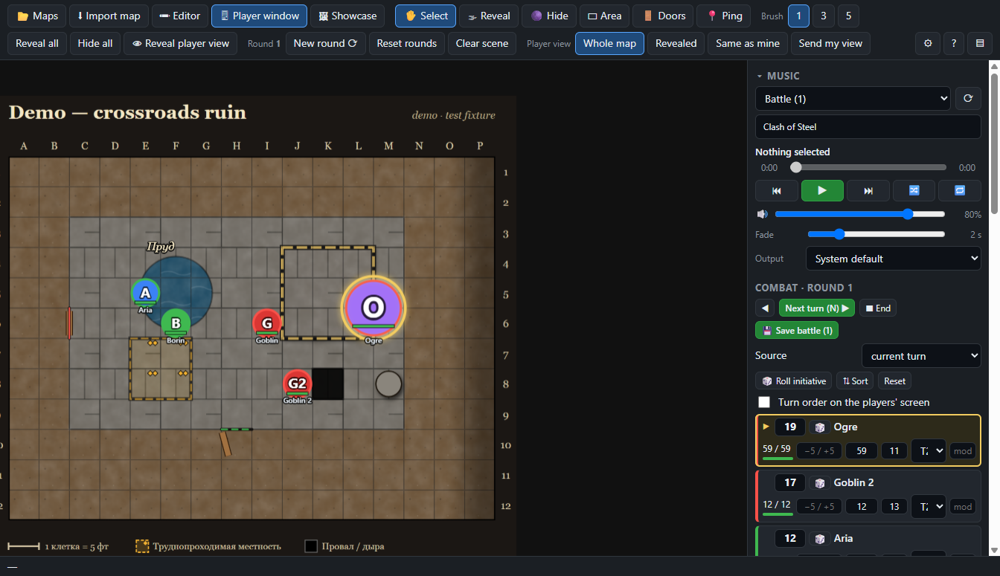
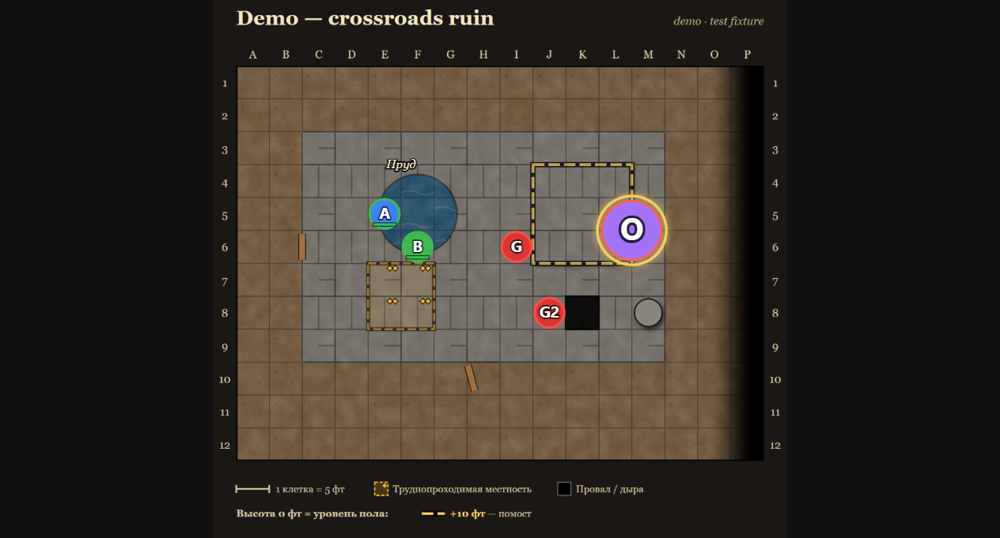
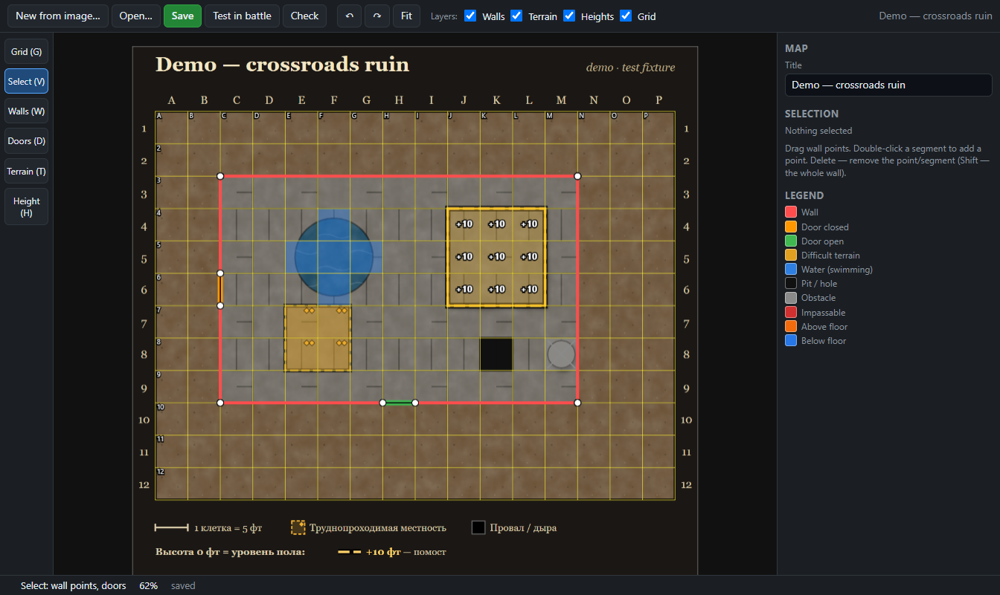
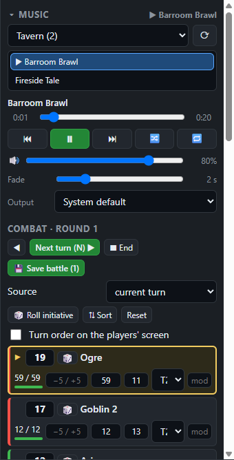

# Universal DnD Battle map

**English** | [Русский](#русский)

A free battle-map tool for tabletop RPG game masters (built around D&D 5e). Run the map on your screen, show a clean view with fog of war to your players on a second screen. Windows desktop app, works fully offline.



## Features

- Grid battle maps with fog of war, doors, walls that block sight and movement, difficult terrain, water and heights.
- Tokens, ruler, ping, undo; a token library you can extend.
- **Two screens:** a GM window and a clean player window for a second monitor or projector.
- Combat: initiative, HP, conditions, counters, dice roller (`2d20kh1+5`), battle log saved as a note.
- **Showcase:** show portraits, crests and illustrations to the players.
- **Music:** playlists from folders, crossfade, choose the output device (e.g. speakers while you wear headphones).
- **Map editor:** make a map from any image: grid, walls, doors, terrain, heights, check, test in battle.
- Several campaigns, export/import `.udbm`, English and Russian interface, auto-update, problem report.

| Player window (second screen) | Map editor |
|---|---|
|  |  |



## Download

Get the latest version from the **[Releases page](https://github.com/KrantOj/universal-dnd-battle-map/releases/latest)**:

- `Universal-DnD-Battle-map-Setup-<version>.exe` — installer (recommended, updates itself);
- `Universal-DnD-Battle-map-<version>-portable.exe` — no installation, runs from any folder (tells you about new versions, does not install them).

**SmartScreen.** The files are not signed with a publisher certificate yet, so Windows may show "Windows protected your PC". Click **More info → Run anyway**. Download only from this repository's Releases page.

On first launch a short wizard sets up your campaign (folders for maps, images, music). See the **[User guide](docs/USER-GUIDE.en.md)**.

### Optional: token library

A ready-made set of tokens is published separately as the **[extras-tokens-1](https://github.com/KrantOj/universal-dnd-battle-map/releases/tag/extras-tokens-1)** release. Download the `.vtt.json` file from it, rename it to `Библиотека токенов.vtt.json` and put it into your **maps folder** — the app picks it up automatically.

## Build from source

Requires Node.js 20+ and Git.

```
git clone https://github.com/KrantOj/universal-dnd-battle-map.git
cd universal-dnd-battle-map
npm i
node node_modules/electron/install.js
npm start
```

`node node_modules/electron/install.js` downloads the Electron binary (npm blocks install scripts by default). Tests: `npm test`; end-to-end run: `npm run smoke`; installers: `npm run dist` (output in `dist/`). Release process: [docs/RELEASE.md](docs/RELEASE.md). Architecture and map format: [docs/ARCHITECTURE.md](docs/ARCHITECTURE.md), [docs/MAP-FORMAT.md](docs/MAP-FORMAT.md).

## License

[MIT](LICENSE) © 2026 KrantOj

---

# Русский

Бесплатная программа для мастеров настольных ролевых игр (заточена под D&D 5e): боевая карта на вашем экране и чистое окно с туманом войны для игроков на втором экране. Приложение для Windows, работает без интернета.


## Возможности

- Карты с сеткой, туман войны, двери, стены, закрывающие обзор и движение, труднопроходимая местность, вода и высоты.
- Токены, линейка, пинг, отмена действий; библиотека токенов, которую можно пополнять.
- **Два экрана:** окно мастера и чистое окно для игроков на втором мониторе или проекторе.
- Бой: инициатива, HP, состояния, счётчики, кубики (`2d20kh1+5`), журнал боя в виде заметки.
- **Показ:** портреты, гербы и иллюстрации игрокам.
- **Музыка:** плейлисты из папок, кроссфейд, выбор устройства вывода (например, колонки, пока вы в наушниках).
- **Редактор карт:** карта из любой картинки — сетка, стены, двери, местность, высоты, проверка, «Проверить в бою».
- Несколько кампаний, экспорт и импорт `.udbm`, интерфейс на русском и английском, автообновление, отчёт о проблеме.

| Окно игроков (второй экран) | Редактор карт |
|---|---|
|  |  |


## Скачать

Последняя версия — на странице **[Releases](https://github.com/KrantOj/universal-dnd-battle-map/releases/latest)**:

- `Universal-DnD-Battle-map-Setup-<версия>.exe` — установщик (рекомендуется, обновляется сам);
- `Universal-DnD-Battle-map-<версия>-portable.exe` — без установки, запускается из любой папки (о новых версиях сообщает, но не ставит их).

**SmartScreen.** Файлы пока не подписаны сертификатом издателя, поэтому Windows может показать «Система Windows защитила ваш компьютер». Нажмите **Подробнее → Выполнить в любом случае**. Скачивайте только со страницы Releases этого репозитория.

При первом запуске короткий мастер настроит кампанию (папки карт, картинок, музыки). Подробности — в **[руководстве](docs/USER-GUIDE.ru.md)**.

### По желанию: библиотека токенов

Готовый набор токенов лежит отдельным релизом **[extras-tokens-1](https://github.com/KrantOj/universal-dnd-battle-map/releases/tag/extras-tokens-1)**. Скачайте оттуда файл `.vtt.json`, переименуйте в `Библиотека токенов.vtt.json` и положите в **папку карт** — приложение подхватит его само.

## Сборка из исходников

Нужны Node.js 20+ и Git.

```
git clone https://github.com/KrantOj/universal-dnd-battle-map.git
cd universal-dnd-battle-map
npm i
node node_modules/electron/install.js
npm start
```

`node node_modules/electron/install.js` скачивает бинарник Electron (npm по умолчанию блокирует install-скрипты). Тесты: `npm test`; сквозной прогон: `npm run smoke`; установщики: `npm run dist` (результат в `dist/`). Выпуск релиза: [docs/RELEASE.md](docs/RELEASE.md). Архитектура и формат карты: [docs/ARCHITECTURE.md](docs/ARCHITECTURE.md), [docs/MAP-FORMAT.md](docs/MAP-FORMAT.md).

## Лицензия

[MIT](LICENSE) © 2026 KrantOj
